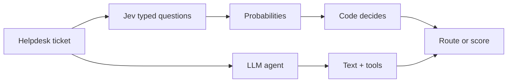
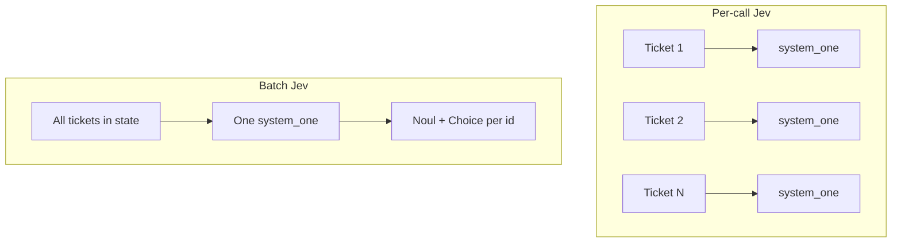
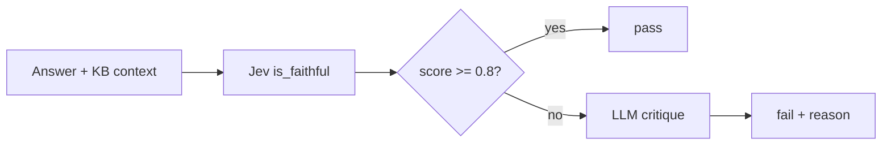
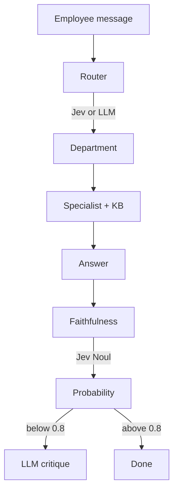

# Why we use Jev for routing and evals

This workshop uses [TypeSafe Jev](https://typesafe.ai) for two jobs that look like “AI” but are really **judgments**:

1. **Routing** — which department should handle a ticket?
2. **Evaluation** — is an HR answer faithful to the retrieved knowledge base?

Chat models are good at conversation and tool use. Jev is built for **typed questions** that return **calibrated probabilities**, so application code can threshold, log, and act. That split is the main idea: **Jev judges, code decides**; LLMs still generate answers where we need language.

---

## How it differs from an LLM agent

| | LLM agent (e.g. `gpt-6-luna`) | Jev |
| --- | --- | --- |
| Output | Free-form text + tool calls | Choice / Noul / Score with probabilities |
| Control | Prompt wording | Criteria + thresholds in code |
| Cost shape | Input + output tokens | Input only (~$42/BTok ≈ $0.042/MTok; output free) |
| Best for | Writing, multi-step tools, RAG answers | Classify, gate, score |



---

## What we implemented

### Routing

Each ticket is scored with two questions in one TypeSafe request:

- **Noul** — is this a real helpdesk request?
- **Choice** — which department (IT, HR, Facilities, Finance, Legal, Security)?

Code applies thresholds (e.g. low Noul → `None` / not a ticket) and escalates. Confusing cases (employee expenses → HR vs vendor invoice → Finance) are spelled out in Choice criteria.

We also support **batch routing**: all tickets in `state`, one `system_one` call, a Noul+Choice pair per example id.



### Faithfulness eval (“AI as a judge”)

After the HR specialist answers from the KB:

1. Jev **Noul**: probability the response is faithful to retrieved context  
2. If score ≥ **0.8** → pass, no LLM call  
3. If below threshold → LLM critique (same prompt as the always-on judge)

That keeps expensive critiques for borderline or failing cases. Faithfulness Nouls can also be **batched** across a dataset in one TypeSafe call.



---

## Example results: routing

Dataset: `live_workshop_routing.jsonl` (11 examples). Agent: `gpt-6-luna`. Jev: `jev-1.14.0`.

| Method | Accuracy | Total time | API calls | Est. cost |
| --- | --- | --- | --- | --- |
| LLM agent (escalate-only) | **8/11 (73%)** | 31.3 s | 11 | **$0.000829** |
| Jev (per call) | **11/11 (100%)** | 1.1 s | 11 | **$0.000319** |
| Jev (batch) | **11/11 (100%)** | **0.23 s** | **1** | **$0.000217** |

Vs the agent, batch Jev was about **135× faster** and **~3.8× cheaper** on this run (list prices as of 2026-10-30). Vs per-call Jev, batch was still **~4.8× faster** and **~1.5× cheaper**.

Agent misses that Jev got right on this set:

| Example | Expected | Agent said |
| --- | --- | --- |
| live_002 | HR | Finance |
| live_004 | HR | Finance |
| live_010 | IT | Security |

---

## Example results: faithfulness judge

Same specialist answers for every method; only the **judge** is timed and costed.

Dataset: `live_workshop_hr.jsonl` (6 examples). Threshold: **0.8**.

| Method | Pass rate | Agree w/ LLM judge | Total time | Calls | Est. cost |
| --- | --- | --- | --- | --- | --- |
| LLM judge (always) | 5/6 (83%) | — | 21.2 s | 6 | **$0.001265** |
| Jev per-call (+ LLM on fail) | 6/6 (100%) | 5/6 | 0.70 s | 6 | **$0.000292** |
| Jev batch (+ LLM on fail) | 6/6 (100%) | 5/6 | **0.25 s** | **1** | **$0.000246** |

All Jev scores cleared 0.8, so **no** LLM critiques ran. Batch Jev was about **85× faster** and **~5× cheaper** than always-on LLM judging.

One disagreement (`live_hr_002`): LLM fail vs Jev pass (~0.94). A probability plus a threshold is often more useful than a single binary essay.

---

## Why this matters for evals and routing

1. **Fit the job** — classification and faithfulness are judgments; typed answers beat prose you have to parse.  
2. **Latency** — no tool loops for “which department?”; batch evals in one round trip.  
3. **Cost** — Jev input-only pricing; hybrid evals reserve LLM spend for fails.  
4. **Control** — criteria and thresholds live next to code, easy to audit and change.  
5. **Complementary** — keep LLMs for generation and RAG; use Jev to route and score.



---

## Re-run the benches

```bash
uv run python scripts/compare_routing_bench.py \
  --dataset data/live_workshop_routing.jsonl

uv run python scripts/compare_hr_judge_bench.py \
  --dataset data/live_workshop_hr.jsonl
```

Rates: [`src/helpdesk/pricing.py`](../src/helpdesk/pricing.py). Setup detail: [jev_router.md](jev_router.md), [jev_hr_judge.md](jev_hr_judge.md).

**Bottom line:** use chat models to generate; use Jev to classify and score; use code to decide. For routing and faithfulness evals, that is faster, cheaper, and easier to operate than asking an LLM to do everything in free text.
